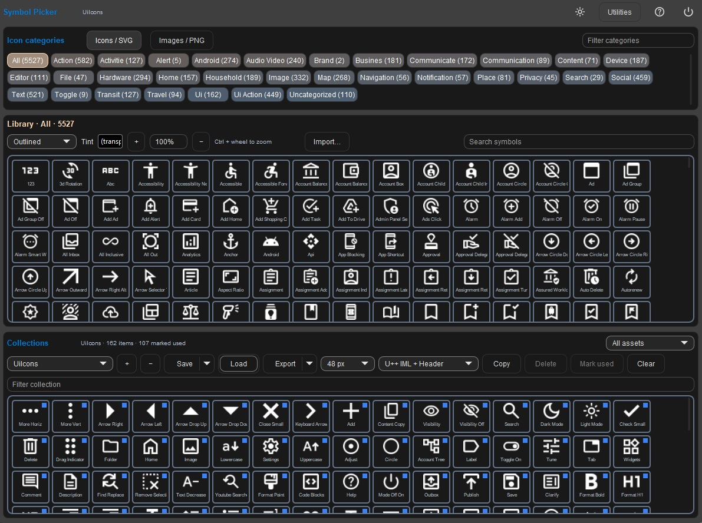

# UiSymbolPicker

A U++ desktop tool for finding, trying and maintaining icons for your applications.



- Browse 4,150 Material Symbols in outlined, rounded and sharp styles.
- Choose 20 or 48 optical artwork, with Filled on or off; export pixel size is independent.
- Filter by category, name or Google search tags and zoom with the buttons or Ctrl+wheel.
- Resize Library and Collections with the draggable divider.
- Build application collections, including your own SVGs and images.
- Save reference-based `.symbolpicker` projects and return to edit them later.
- Export PNG, SVG, C++ snippets, RAW/RLE headers or U++ IML/header libraries.
- Compare and prepare catalogue updates using the built-in Utilities window.
- Scan application code to help mark icons as used.

The gallery renders previews lazily and keeps a bounded cache for large libraries.
Olive light and dark themes are supported throughout the main window and utilities.
Choose a foreground tint and a preview background to check icons against your
application's colours. Preview backgrounds apply to both galleries; exports retain transparency.

## Getting started

Launch `bin/windows-x64/UiSymbolPicker.exe` from a release bundle, or build from source.
Choose **Icons / SVG** or **Images / PNG**, select a category, and add items to a
collection. Each collection can represent an application's asset set.

Try [UiIconsBase.symbolpicker](examples/UiIconsBase.symbolpicker) for the 71-icon
base set or [UiIcons.symbolpicker](examples/UiIcons.symbolpicker) for the compatible
162-icon shared Ui set.
Projects store references rather than embedded artwork. Keep custom source files
available for future editing and exports; exported application assets are independent.

- [Application icon workflow](docs/ICON_WORKFLOW.md)
- [Updating the Material catalogue](docs/MATERIAL_CATALOGUE_UPDATES.md)

## Building from source

Use the Ultimate++ IDE with these source nests in your assembly:

- this repository;
- `upp_Ui`, including `Utilities/IconExportCore`;
- `upp_animation` and `upp_statemachine`;
- the Ultimate++ `uppsrc` directory.

Open the `UiSymbolPicker` package, select a Windows x64 build method and build
with the GUI flag. Set the assembly output directory to `build/`. To distribute
the application, place the Release executable in `bin/windows-x64/` and copy the
optional `assets/` directory beside it. Local binaries and build output are ignored
by Git.

Prepared release downloads are kept under `bin/release/`, with an unpacked
Windows x64 bundle, a ZIP, checksums and GitHub release text.

## Repository layout

```text
UiSymbolPicker/   application and compiled catalogue
assets/           optional custom SVG and image sources
examples/         sample application collections
docs/             usage and catalogue maintenance guides
build/            local build output (ignored)
bin/windows-x64/  latest executable and optional assets
bin/release/      prepared release bundle and ZIP (ignored)
```

## Licence

See [LICENSE](LICENSE) for GNU GPLv3. Material Symbols source attribution and
licence are retained in `UiSymbolPicker/Generated/`.
